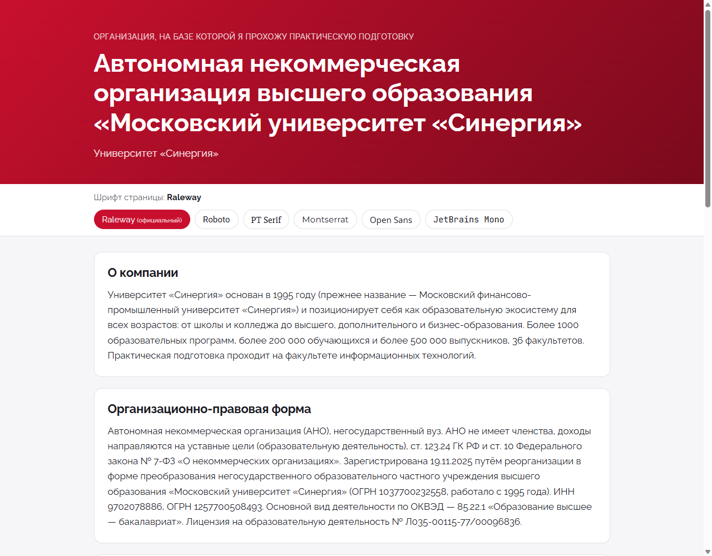
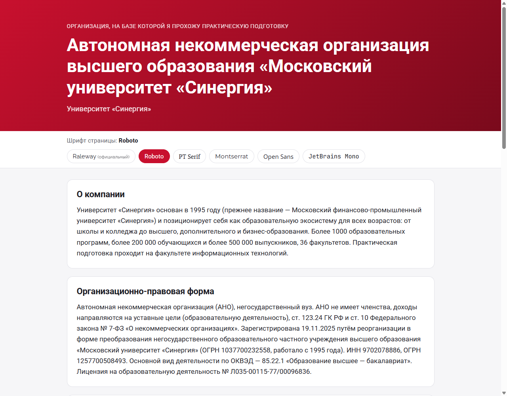
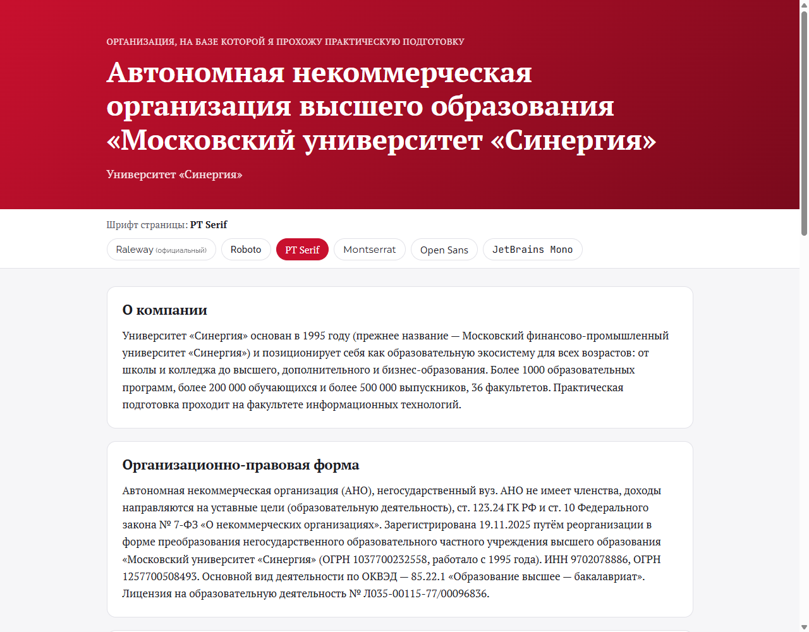
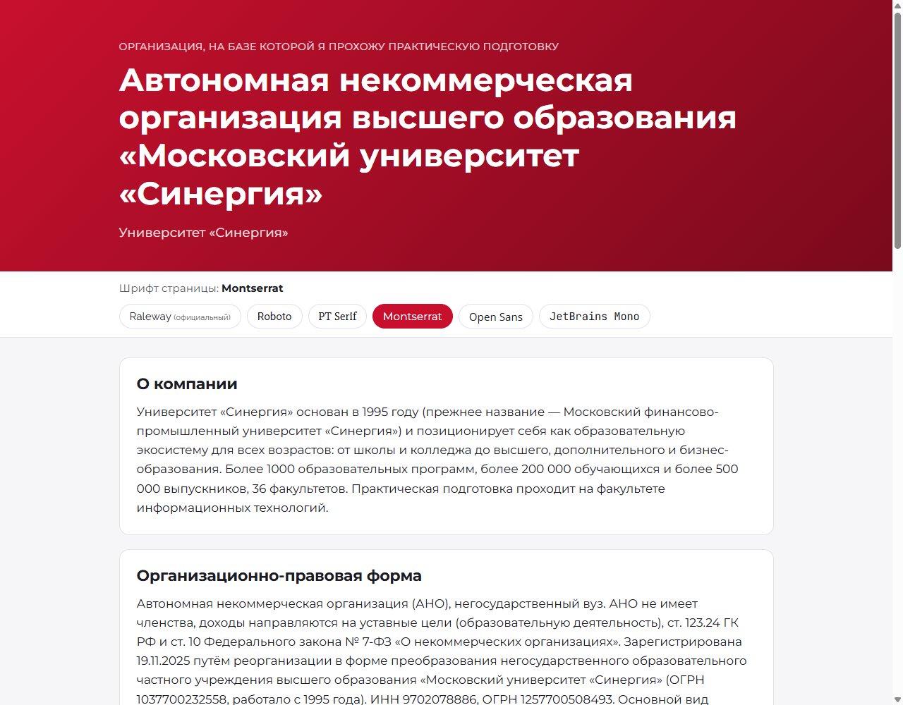
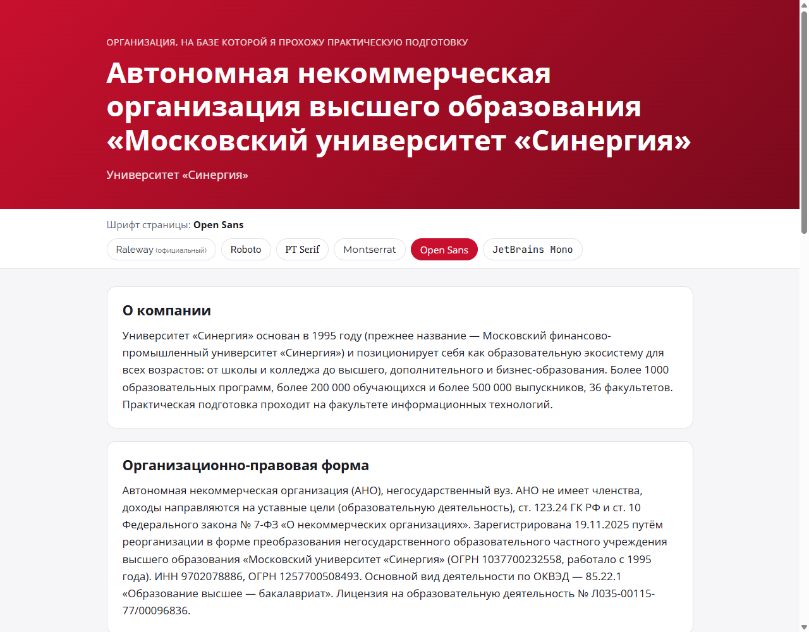
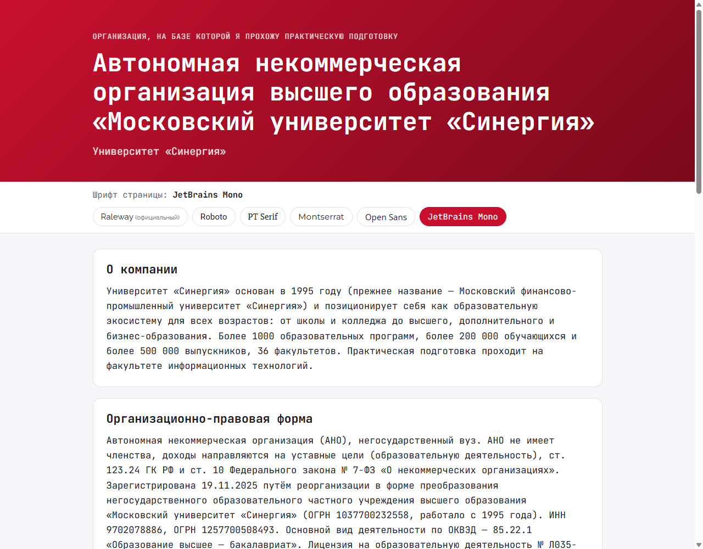

# synergy-practice-html

Генератор HTML-страницы об организации, на базе которой проходит практическая подготовка:
**Университет «Синергия»** (АНО ВО «Московский университет «Синергия»).

**Страница:** https://filippovdaniil.github.io/synergy-practice-html/

## Задание (кейс-задача № 5)

> Напишите программу, которая будет генерировать HTML-страницу с заголовком «Наименование организации
> на базе, которой Вы проходите практическую подготовку» и информацией об организации.
> Также добавьте к странице CSS-стили, чтобы текст тем же шрифтом что и официальный шрифт компании.
> Попробуйте представить еще 5 вариантов шрифтов.

## Что делает программа

`html_generator` (C++17) читает `data/organization.json` и создаёт папку `site/` с двумя файлами:

- `index.html`. Заголовок `<h1>` содержит официальное название организации. Разделы: «О компании», «Организационно-правовая форма», «Виды деятельности», «Адрес и география», «Контакты и сайт», «Сравнение шрифтов».
- `styles.css`. Основной шрифт задаётся CSS-переменной `--font-main`; по умолчанию это официальный шрифт **Raleway**.

На странице есть переключатель шрифтов (официальный и 5 альтернатив, инлайн-JS короче 20 строк) и блок сравнения: один и тот же абзац набран всеми 6 шрифтами с подписью класса шрифта.
Ссылка вида `#font-N` (N = 0…5) сразу открывает страницу нужным шрифтом, например [`#font-2`](https://filippovdaniil.github.io/synergy-practice-html/#font-2) для PT Serif.

Шрифты подключаются из Google Fonts одной ссылкой на все 6 семейств, кириллица поддерживается. Все строки из JSON экранируются функцией `escapeHtml`. Файлы пишутся в UTF-8 без BOM.

## Шрифты

| # | Шрифт | Класс | Почему выбран |
|---|-------|-------|---------------|
| 0 | **Raleway** (официальный) | геометрический гротеск | Основной `font-family` на сайте synergyuniversity.ru (проверено 12.10.2026); есть в Google Fonts с кириллицей |
| 1 | Roboto | неогротеск | Нейтральный экранный шрифт Material Design, хорошо читается в интерфейсах LMS и мобильного приложения |
| 2 | PT Serif | антиква | Шрифт с засечками от ParaType, изначально спроектирован под кириллицу; подходит для официальных документов и длинного текста |
| 3 | Montserrat | геометрический гротеск | Ближайший по характеру к Raleway: геометрический, широкий, хорошо смотрится в заголовках |
| 4 | Open Sans | гуманистический гротеск | Открытые формы букв дают высокую разборчивость мелкого текста на любых экранах |
| 5 | JetBrains Mono | моноширинный | Моноширинный шрифт для IT-факультета: подходит для фрагментов кода и технических материалов |

## Скриншоты

| Raleway (официальный) | Roboto |
|---|---|
|  |  |

| PT Serif | Montserrat |
|---|---|
|  |  |

| Open Sans | JetBrains Mono |
|---|---|
|  |  |

## Сборка и запуск

Нужны CMake ≥ 3.20 и компилятор с поддержкой C++17. Зависимости (`nlohmann/json` v3.11.3 и googletest v1.15.2) CMake скачивает сам через `FetchContent`.

```bash
cmake -S . -B build
```
```bash
cmake --build build
```
```bash
ctest --test-dir build --output-on-failure
```
```bash
./build/html_generator data/organization.json site
```

Оба аргумента необязательны, по умолчанию используются `data/organization.json` и `site`. Программа печатает путь к созданному `index.html`.
При ошибке во входных данных (битый JSON, нет обязательного поля, альтернативных шрифтов не 5) она выводит понятное сообщение и завершается с кодом 1.

## Структура

| Путь | Назначение |
|------|------------|
| `include/gen/organization.hpp`, `src/organization.cpp` | Структуры `Organization` и `Font`, функция `loadOrganization`, валидация входных данных |
| `include/gen/html.hpp`, `src/html.cpp` | `escapeHtml`, `renderHtml` |
| `include/gen/css.hpp`, `src/css.cpp` | `renderCss` |
| `src/main.cpp` | Разбор аргументов и запись файлов |
| `tests/` | Тесты googletest: модель, HTML, CSS |
| `data/organization.json` | Данные организации |
| `.github/workflows/pages.yml` | CI: сборка → `ctest` → генерация → деплой на GitHub Pages |

Логика рендера реализована чистыми функциями (на выходе строка), поэтому тесты не трогают файловую систему.

## Источники данных

Официальный сайт [synergyuniversity.ru](https://synergyuniversity.ru), раздел [«Сведения об образовательной организации»](https://synergyuniversity.ru/sveden), отчётность НКО на [nco.minjust.gov.ru](https://nco.minjust.gov.ru).
Название, организационно-правовая форма, юридический адрес, ИНН/ОГРН и ОКВЭД сверены с выпиской ЕГРЮЛ ([egrul.nalog.ru](https://egrul.nalog.ru)) от 12.10.2026: АНО ВО «Московский университет «Синергия», ИНН 9702078886, ОГРН 1257700508493. Организация создана 19.11.2025 преобразованием НОЧУ ВО «Московский университет «Синергия» (ИНН 7729152149, ОГРН 1037700232558).
